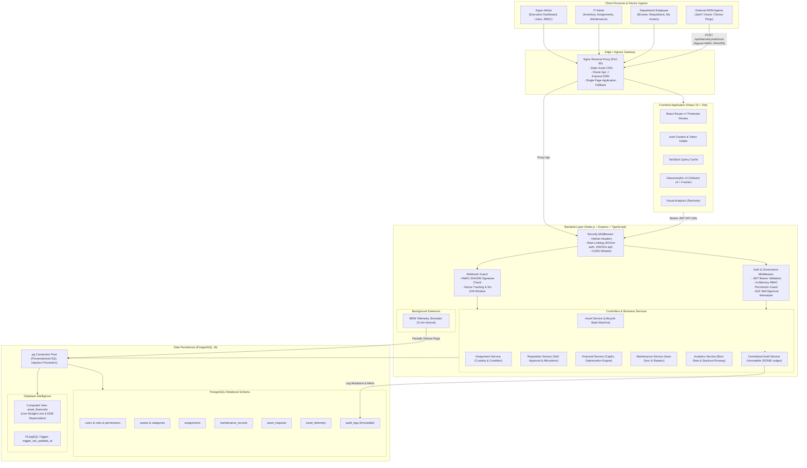
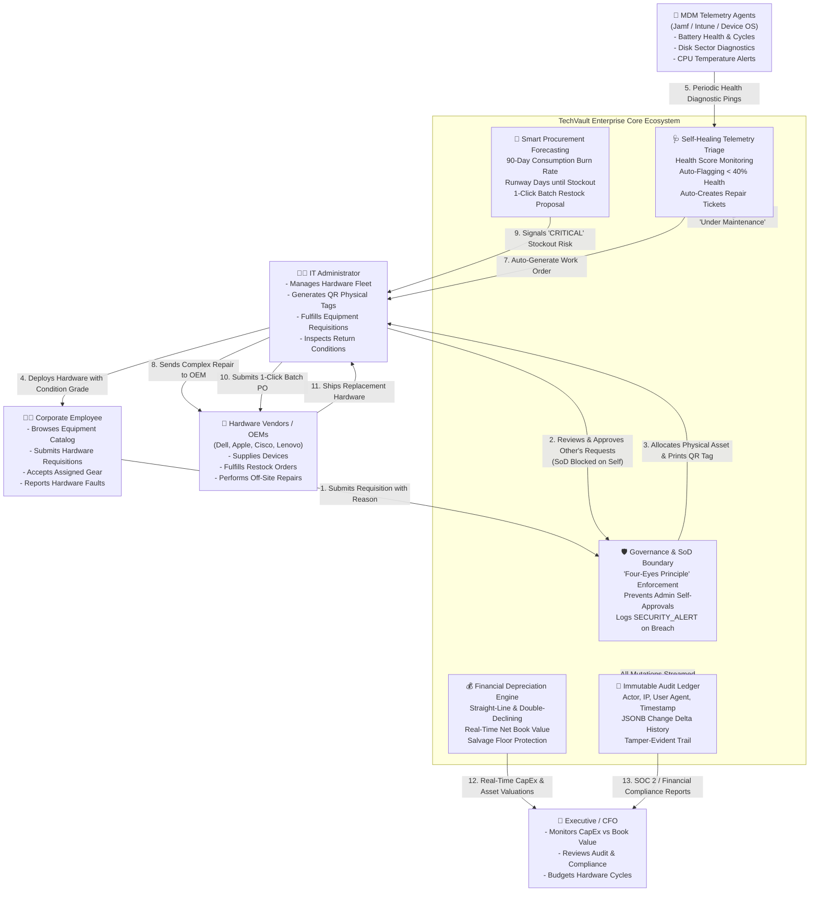
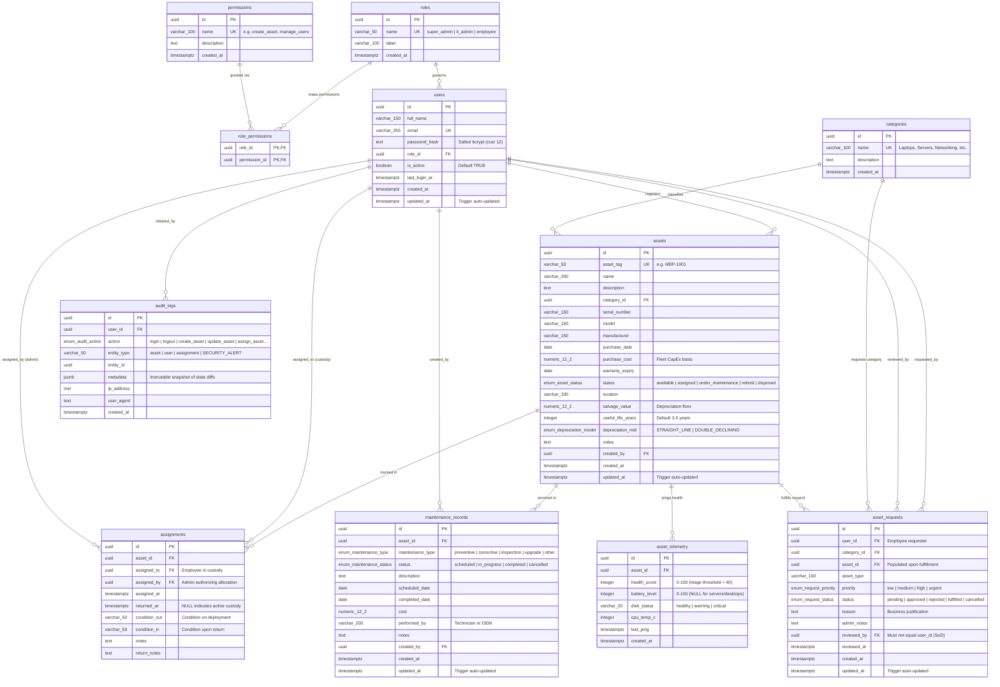

```mermaid
graph TD
    Root["TechVault Enterprise ITAM System"]

    %% Level 1 Branches
    Root --> P1["1.0 Project Management & Governance"]
    Root --> P2["2.0 Database & Infrastructure"]
    Root --> P3["3.0 Backend Core Services"]
    Root --> P4["4.0 Frontend & User Experience"]
    Root --> P5["5.0 Capstone Advanced Pillars"]
    Root --> P6["6.0 QA, Security & DevOps"]

    %% 1.0 PM
    P1 --> P1_1["1.1 Requirements & User Personas"]
    P1 --> P1_2["1.2 Milestone Planning & Gantt"]
    P1 --> P1_3["1.3 ERP/ITIL Compliance Standards"]

    %% 2.0 DB
    P2 --> P2_1["2.1 Normalized PostgreSQL Schema"]
    P2 --> P2_2["2.2 7 Sequential Migrations Engine"]
    P2 --> P2_3["2.3 Computed SQL Views & Triggers"]
    P2 --> P2_4["2.4 Seed Datasets (Fleet & Users)"]

    %% 3.0 Backend
    P3 --> P3_1["3.1 JWT Auth & bcrypt Hashing"]
    P3 --> P3_2["3.2 Granular RBAC Middleware"]
    P3 --> P3_3["3.3 Asset & Custody REST APIs"]
    P3 --> P3_4["3.4 Requisition & Approval Engine"]
    P3 --> P3_5["3.5 Immutable Audit Logging Service"]

    %% 4.0 Frontend
    P4 --> P4_1["4.1 React 19 + Tailwind v4 Shell"]
    P4 --> P4_2["4.2 11-Section Enterprise Landing Page"]
    P4 --> P4_3["4.3 Operations Dashboard & Recharts"]
    P4 --> P4_4["4.4 Asset Register & Vector QR Modal"]
    P4 --> P4_5["4.5 Requisitions Queue & SoD Tooltips"]
    P4 --> P4_6["4.6 Browser-Safe CSV Export Utility"]

    %% 5.0 Capstone Pillars
    P5 --> P5_1["5.1 Financial Depreciation Engine"]
    P5 --> P5_2["5.2 Segregation of Duties (SoD) Guard"]
    P5 --> P5_3["5.3 MDM Telemetry & Auto-Maintenance"]
    P5 --> P5_4["5.4 Smart Procurement Forecasting"]

    %% 6.0 QA & DevOps
    P6 --> P6_1["6.1 Node.js Automated Test Suite"]
    P6 --> P6_2["6.2 Webhook HMAC & Replay Guards"]
    P6 --> P6_3["6.3 Multi-Stage Docker & Compose V2"]
    P6 --> P6_4["6.4 Nginx Reverse Proxy Config"]
```

# TechVault — Project Progress, Roadmap & Master Diagram Prompts
> **Document Title:** Project Status Report, Unfulfilled Roadmap & Comprehensive Diagram Engineering Prompts  
> **Target Date:** June – August Delivery Cycle  
> **Status:** Production-Ready Core + 4 Capstone Pillars Complete | Active Extension Roadmap  

---

## 1. Executive Summary & Primary Goal

### 1.1 The Primary Goal
The primary objective of **TechVault** is to deliver a production-grade, enterprise-class **IT Asset Management (ITAM) and Hardware Lifecycle Governance Platform** designed in accordance with **ERP** and **ITIL** standards. 

Legacy organizations often track multi-million-dollar physical hardware portfolios through disconnected spreadsheets, resulting in "ghost assets", unreturned hardware during employee offboarding, unexpected stockouts, and audit non-compliance. TechVault solves this by centralizing:
1. **Full-Cycle Custody Tracking:** From hardware intake, procurement tagging, and deterministic QR code generation, to employee assignment, condition inspection, and end-of-life disposal.
2. **ERP-Grade Governance (Segregation of Duties):** SOX/SOC 2 compliant "Four-Eyes" approval pipelines preventing self-allocation of corporate assets.
3. **Financial Accounting Integration:** Real-time CapEx tracking, dynamic Straight-Line and Double-Declining depreciation models, and live book-value computation with salvage floors.
4. **Predictive Supply Chain Management:** Real-time consumption velocity (burn rates) and stockout runway projections to avoid procurement emergencies.
5. **Autonomous Device Health Monitoring:** Simulated MDM telemetry with auto-triage workflows that shift degraded devices (< 40% health) into preventative maintenance automatically.

---

## 2. What Has Been Done So Far (Detailed Progress)

Every foundational milestone, capstone pillar, and trust/reliability enhancement has been implemented, validated, and verified live:

### 2.1 Core Platform & Infrastructure
* **Architecture & Monorepo Foundation:** Clean separation between client (`client/`) and server (`server/`) with TypeScript ESM, shared interface contracts, and centralized error handling.
* **Database Architecture & Migrations:** 7 idempotent SQL migrations executed via a custom PostgreSQL runner (`server/src/db/migrate.ts`), complete with UUID primary keys, custom enums (`asset_status`, `maintenance_type`, `request_status`, `audit_action`), and PL/pgSQL automated timestamp triggers.
* **Authentication & RBAC:** Salted bcrypt hashing (cost factor 12) + 7-day stateless JWT authentication. In-memory cached permission evaluation engine supporting 3 primary roles (`super_admin`, `it_admin`, `employee`) across 10 fine-grained permissions.
* **Core RESTful Services:** Complete CRUD pipelines for Assets, Categories, Assignments, Maintenance Records, Requisitions, Users, and Audit Logs with Zod schema validation and parameterized SQL queries.
* **Modern Glassmorphic Client:** React 19 SPA built with Tailwind CSS v4, Framer Motion page transitions, Lucide React icons, and TanStack Query v5 for server-state caching.
* **Production Dockerization:** Multi-stage production Dockerfiles for client and server orchestrated via Docker Compose V2 with an Nginx reverse proxy serving port 80.

### 2.2 Rich Enterprise Seed Data & Workflows
* **Pre-Seeded Fleet:** 25 enterprise hardware assets (MacBook Pros, ThinkPads, Dell OptiPlex desktops, PowerEdge rack servers, Cisco switches, 4K monitors) across all lifecycle states.
* **Pre-Seeded User Directory:** 11 active corporate users spanning Engineering, Product, IT Operations, Infrastructure, and HR.
* **Employee Requisition Workflow:** Complete requisition engine allowing employees to submit equipment requests with priority and rationale, and administrators to review, approve, reject, or fulfill them.
* **11-Section Enterprise Landing Page (`/`):** High-converting public landing page featuring dynamic live metrics, feature showcases, compliance highlights, interactive ROI calculator, and quick-login test pills.

### 2.3 The 4 Advanced Enterprise Capstone Pillars
* **Pillar 1: Financial Lifecycle & Depreciation Engine:**
  * Added `salvage_value`, `useful_life_years`, and `depreciation_mdl` (`STRAIGHT_LINE`, `DOUBLE_DECLINING`) to assets.
  * Created dynamic SQL computed view `asset_financials` computing age in fractional years, annual depreciation, and real-time net book value.
  * Added Dashboard `FinancialWidget` displaying fleet CapEx ($64,517) vs. Net Book Value ($18,711) and value retention ratio.
* **Pillar 2: ERP-Grade Segregation of Duties (SoD):**
  * Backend rule in `request.service.ts` blocks administrators from reviewing/approving/rejecting requisitions they created themselves (`request.user_id === reviewerId`).
  * Self-approval attempts return `403 Forbidden` and record a `SECURITY_ALERT` (`SOD_VIOLATION`) in `audit_logs`.
  * Frontend UI disables review buttons, displays amber warning badges, and renders an SoD policy explanation tooltip.
* **Pillar 3: Simulated MDM Telemetry & Autonomous Maintenance:**
  * `asset_telemetry` table stores `health_score`, `battery_level`, `disk_status`, and `cpu_temp_c`.
  * In-memory background daemon (`startTelemetrySimulator`) simulates realistic device pings every 3 minutes.
  * Autonomous triage pipeline: devices with `health_score < 40%` automatically switch status to `under_maintenance` and generate a `[System Auto-Flagged]` repair ticket.
  * Dynamic pulsing health badges on the inventory table indicating battery and disk health.
* **Pillar 4: Smart Procurement Forecasting & Stockout Runway:**
  * Engine computes 90-day assignment velocity (daily/monthly burn rate) per category.
  * Dynamically computes runway days until stockout, categorizing risk as `CRITICAL` (≤ 14d), `WARNING` (15–45d), or `HEALTHY` (> 45d).
  * Calculates suggested reorders to maintain a 90-day supply buffer.
  * Interactive "Procurement Forecast" tab on Dashboard featuring KPI cards, Recharts comparative analytics, a risk matrix table, and a 1-click batch restock modal.

### 2.4 Trust, Reliability & Security Hardening (P0 & P1)
* **Webhook HMAC-SHA256 Authentication:** Timing-safe verification using `crypto.timingSafeEqual()`, 5-minute anti-replay timestamp window, and nonce deduplication cache.
* **IDOR Elimination:** Strict ownership scoping on employee assignments (`/api/assignments/user/:userId`) and role-based restrictions on audit logs, financials, and analytics.
* **Automated Test Suite (13 Tests):** Node native test harness (`node:test`) passing 13 automated tests across depreciation formulas, forecasting runway logic, SoD enforcement, and webhook HMAC validation.
* **Physical QR Code Identification:** Deterministic vector QR modal (`AssetQrModal.tsx`) with Avery-style printable asset tag labels.
* **Data Export Engine:** Browser-safe CSV export utility on the Asset Registry and Procurement Forecast matrix.
* **Permission Alignment:** Updated `server/src/routes/user.routes.ts` so IT Administrators can list the user directory to populate assignment dropdowns while keeping user creation/editing locked to Super Admin.

---

## 3. What Is Left To Do (Future Roadmap & Unfulfilled Opportunities)

While the core platform and all 4 Capstone pillars are complete and operational, the following high-impact enhancements represent the next evolutionary phase (P1/P2) for enterprise deployment:

### Phase A: Extended Lifecycle & Offboarding Workflows (High Priority)
1. **Automated Employee Offboarding Checklist:**
   * Single-click offboarding pipeline for HR/IT: when an employee leaves, automatically aggregate all assigned equipment, generate a recovery checklist, send return reminder notices, and mark unreturned items as "Pending Return" or "Flagged as Lost".
2. **Vendor Management & Warranty Claims (RMA) Portal:**
   * Extend vendors beyond string names: create a dedicated `vendors` table tracking supplier contacts, support phone/email, contract PDFs, and SLA response times.
   * Add a Warranty Claim (RMA) ticket workflow to track hardware sent back to OEMs (Dell, Apple, Lenovo) under warranty coverage.

### Phase B: Real-World Integrations & External Connectivity
3. **Live MDM Webhook Connectors:**
   * Replace/augment the simulated MDM worker with live webhook ingestion endpoints for **Apple Jamf Pro**, **Microsoft Intune**, and **Kandji**.
   * Automatic asset synchronization: ingest serial numbers, OS build versions, FileVault encryption status, and lock status directly from live agent reports.
4. **Automated Notification Dispatcher (Email / Slack / Teams):**
   * Configurable webhooks to dispatch instant alerts when:
     * A device drops below 40% health (Slack `#it-alerts` channel).
     * A hardware category reaches `CRITICAL` stockout runway (Procurement team notification).
     * A requisition is submitted or approved (Email to employee).

### Phase C: Software Asset Management (SAM) & Reporting
5. **Software License & SaaS Subscription Tracking:**
   * Manage software licenses (e.g., JetBrains, Adobe Creative Cloud, Microsoft 365, AWS seats).
   * Track seat allocations against purchased quantities and flag over-allocation risks.
6. **Executive PDF Audit Report Generation:**
   * Server-side PDF export engine (via Puppeteer or PDFKit) generating auditable compliance reports with digital watermarks, signature blocks, and asset valuation summaries for accounting auditors.

---

## 4. Master Diagram Prompts & Visual Models

Below are visual diagrams with embedded Mermaid code, paired with standalone prompts for AI or diagramming tools (PlantUML, Eraser.io, Lucidchart, draw.io, Claude, ChatGPT).

---

### Diagram 1: Work Breakdown Structure (WBS)

#### Embedded Mermaid Visualization


#### Standalone Diagram Prompt (Copy & Paste)
```text
PROMPT FOR WORK BREAKDOWN STRUCTURE (WBS):

Generate an enterprise Work Breakdown Structure (WBS) diagram for "TechVault: Enterprise IT Asset Management & Governance System".

Decompose the project hierarchically across 6 Level-1 Work Packages:
1.0 Project Management & Governance (Requirements, Gantt Tracking, ERP/ITIL Compliance)
2.0 Database & Persistence Layer (PostgreSQL 16, 7 Sequential Migrations, asset_financials Computed View, PL/pgSQL Triggers, 25-Asset & 11-User Seed Fleet)
3.0 Backend Core Services (Node.js/Express in TypeScript, JWT + bcrypt 12 Auth, Dynamic RBAC Middleware, Zod Validation, Immutable Audit Service)
4.0 Frontend & UI Experience (React 19, Tailwind CSS v4, Framer Motion, 11-Section Landing Page, Executive Dashboard, Asset Register, Vector QR Generator, Requisitions Queue)
5.0 Advanced Capstone Pillars (Pillar 1: Straight-Line & DDB Depreciation; Pillar 2: Segregation of Duties SoD Self-Approval Guard; Pillar 3: MDM Telemetry Simulator & Auto-Maintenance Pipeline; Pillar 4: Procurement Burn-Rate & Stockout Runway Forecasting)
6.0 Security Hardening, QA & DevOps (HMAC-SHA256 Webhook Auth with Nonce Anti-Replay, 13-Test node:test Suite, Multi-Stage Dockerfile, Docker Compose V2, Nginx Reverse Proxy)

Style Requirements:
- Use clean hierarchical tree layout.
- Clearly differentiate deliverables from sub-tasks.
- Ensure terminal nodes represent testable technical deliverables.
```

---

### Diagram 2: Gantt Chart (June – August Delivery Timeline)

#### Embedded Mermaid Visualization
```mermaid
gantt
    title TechVault Enterprise ITAM — Delivery Schedule (June - August)
    dateFormat  YYYY-MM-DD
    axisFormat  %b %d

    section Phase 1: Inception & Core Arch
    Requirements Analysis & System Design   :done, p1_1, 2026-06-01, 2026-06-08
    Database Schema & Migrations Engine    :done, p1_2, 2026-06-09, 2026-06-16
    JWT Auth, bcrypt & Dynamic RBAC        :done, p1_3, 2026-06-16, 2026-06-23

    section Phase 2: Core Asset & Custody
    Asset CRUD & Parameterized SQL         :done, p2_1, 2026-06-23, 2026-06-30
    Custody Tracking & Condition Auditing  :done, p2_2, 2026-07-01, 2026-07-08
    Maintenance Scheduler & Auto-Sync      :done, p2_3, 2026-07-08, 2026-07-15
    Immutable Audit Logging Service        :done, p2_4, 2026-07-12, 2026-07-18

    section Phase 3: Frontend & Requisitions
    React 19, Tailwind v4 & Layout Shell   :done, p3_1, 2026-07-15, 2026-07-22
    Employee Requisition Workflow          :done, p3_2, 2026-07-20, 2026-07-27
    11-Section Enterprise Landing Page     :done, p3_3, 2026-07-24, 2026-07-31

    section Phase 4: Capstone Pillars
    Pillar 1: Financial Depreciation Engine :done, p4_1, 2026-08-01, 2026-08-06
    Pillar 2: Segregation of Duties (SoD)  :done, p4_2, 2026-08-06, 2026-08-11
    Pillar 3: MDM Telemetry & Auto-Triage   :done, p4_3, 2026-08-11, 2026-08-16
    Pillar 4: Smart Procurement Forecasting :done, p4_4, 2026-08-16, 2026-08-21

    section Phase 5: Hardening & Release
    HMAC Webhook Auth & IDOR Elimination   :done, p5_1, 2026-08-20, 2026-08-24
    Automated Test Suite (13 tests)        :done, p5_2, 2026-08-23, 2026-08-27
    Vector QR Tags & CSV Export Engine     :done, p5_3, 2026-08-26, 2026-08-29
    Docker Compose & Production Validation  :done, p5_4, 2026-08-28, 2026-08-31
```

#### Standalone Diagram Prompt (Copy & Paste)
```text
PROMPT FOR GANTT CHART (JUNE - AUGUST):

Generate a high-detail Gantt chart for the software delivery lifecycle of "TechVault IT Asset Management System", spanning June 1 to August 31.

Structure the schedule across 5 clear sequential phases with milestone dependencies:
1. Phase 1: Inception & Core Foundation (June 1 - June 23)
   - Requirements & System Specification (June 1 - June 8)
   - PostgreSQL 16 Normalized Schema & Idempotent Migration Runner (June 9 - June 16)
   - JWT Authentication, bcrypt work factor 12, and Dynamic RBAC Engine (June 16 - June 23)

2. Phase 2: Core Asset Management & Audit Pipeline (June 23 - July 18)
   - Asset Inventory REST Services & Parameterized Queries (June 23 - June 30)
   - Custody Assignment, Check-in/Check-out, and Condition Inspection (July 1 - July 8)
   - Preventative & Corrective Maintenance Scheduler with Auto-State Sync (July 8 - July 15)
   - Immutable Audit Logging Service with JSONB Diffs (July 12 - July 18)

3. Phase 3: Frontend Experience & Requisitions (July 15 - July 31)
   - React 19 + Tailwind CSS v4 Glassmorphic UI & Router Architecture (July 15 - July 22)
   - Employee Requisition & Approval Queue Workflow (July 20 - July 27)
   - 11-Section Enterprise Landing Page with Quick-Login Pills (July 24 - July 31)

4. Phase 4: Enterprise Capstone Pillars (August 1 - August 21)
   - Pillar 1: Financial Lifecycle, Straight-Line/DDB Depreciation & asset_financials View (Aug 1 - Aug 6)
   - Pillar 2: Segregation of Duties (SoD) Self-Approval Guard & Security Alerts (Aug 6 - Aug 11)
   - Pillar 3: MDM Device Telemetry Simulator & Auto-Maintenance Pipeline (Aug 11 - Aug 16)
   - Pillar 4: Smart Procurement Forecasting, Burn Rate & Stockout Runway (Aug 16 - Aug 21)

5. Phase 5: Security Hardening, Testing & Release (August 20 - August 31)
   - Webhook HMAC-SHA256 Auth, Anti-Replay Nonces & IDOR Protection (Aug 20 - Aug 24)
   - Automated Test Suite Implementation (13 unit tests via node:test) (Aug 23 - Aug 27)
   - Vector QR Code Physical Asset Tags & CSV Data Export Engine (Aug 26 - Aug 29)
   - Multi-Stage Dockerization, Nginx Proxy & Final Capstone Release (Aug 28 - Aug 31)

Output Format: Mermaid gantt syntax or PlantUML project timeline with realistic dependencies and completion markers.
```

---

### Diagram 3: System Architecture Diagram

#### Embedded Mermaid Visualization


#### Standalone Diagram Prompt (Copy & Paste)
```text
PROMPT FOR SYSTEM ARCHITECTURE DIAGRAM:

Generate a comprehensive enterprise System Architecture Diagram for "TechVault: Enterprise IT Asset Management System".

The architecture must illustrate a 4-tier model:
1. Ingress & Client Tier:
   - User Personas: Super Admin, IT Administrator, Employee, and External MDM Agents.
   - Nginx Reverse Proxy Container (Port 80) serving static React SPA bundles and proxying API traffic to port 5000.
   - Frontend Application: React 19, TypeScript, Vite, Tailwind CSS v4, Framer Motion, TanStack Query v5, Recharts, and React Router v7 with Protected Route Guards.

2. API Gateway & Security Pipeline Tier (Node.js + Express):
   - Security Middleware: Helmet (CSP, HSTS), Dual Rate Limiters (Auth: 20 req/15m; Global API: 200 req/15m), CORS origin isolation.
   - Auth & Governance: JWT token verification, in-memory RBAC permission evaluation cache, Segregation of Duties (SoD) violation interceptor.
   - Webhook Ingestion Guard: HMAC-SHA256 timing-safe verification, timestamp drift check (max 5 mins), and nonce replay deduplication.

3. Business Logic & Background Daemons Tier:
   - Modular Domain Services: Asset Lifecycle Service, Assignment & Custody Service, Requisition & Approval Service, Financial Depreciation Engine, Maintenance Operations Service, Smart Procurement Forecasting Service.
   - Centralized Audit Logging Service recording actor ID, IP, user-agent, and JSONB before/after state diffs to an immutable table.
   - Background Simulator: MDM Telemetry Background Worker pulsing hardware health every 3 minutes.

4. Database Persistence Tier (PostgreSQL 16):
   - Connection pool using pg with parameterized queries.
   - Relational tables: users, roles, permissions, categories, assets, assignments, maintenance_records, asset_requests, asset_telemetry, audit_logs.
   - Database Intelligence: asset_financials dynamic computed view calculating real-time straight-line and double-declining book values; PL/pgSQL automated updated_at triggers.

Style Requirements:
- Use layered enterprise architectural container notation (similar to C4 Model Container/Component view).
- Include directional arrows with protocol labels (HTTPS, Bearer JWT, SQL Pool).
```

---

### Diagram 4: Rich Picture (Enterprise Ecosystem & Stakeholder Interactions)

#### Embedded Mermaid Visualization


#### Standalone Diagram Prompt (Copy & Paste)
```text
PROMPT FOR RICH PICTURE DIAGRAM:

Generate an expressive, enterprise-level Rich Picture diagram capturing the operational ecosystem, human actors, external services, and organizational dynamics around "TechVault IT Asset Management System".

Key Entities & Actors to Represent:
1. Corporate Employees (Software Engineers, Designers, Product Managers): Submitting requisitions for hardware upgrades, taking physical custody of laptops/monitors, and returning hardware during transitions.
2. IT Administrators (IT Ops & Systems Engineers): Configuring new assets, sticking printed vector QR tags on laptops, performing check-out condition inspections, processing returns, and scheduling maintenance.
3. Executive Leadership / CFO / Auditors: Reviewing fleet CapEx ($64.5k), monitoring dynamic depreciation book values ($18.7k), and inspecting immutable audit logs for SOX/SOC 2 compliance.
4. Hardware Vendors & OEMs (Apple, Dell, Lenovo, Cisco): Receiving purchase orders triggered by stockout runway warnings and performing off-site warranty repairs.
5. Simulated / Real MDM Agents (Jamf / Microsoft Intune): Silently transmitting telemetry heartbeats (battery cycles, disk status, CPU temp) over signed webhooks.

Internal Platform Pillars:
- Segregation of Duties (SoD) Governance Barrier (rejecting self-approvals).
- Autonomous Self-Healing Pipeline (auto-scheduling maintenance when health drops below 40%).
- Smart Procurement Forecasting (calculating burn rate and runway days).
- Real-Time Financial Depreciation View.
- Centralized Immutable Audit Ledger.

Style Requirements:
- Represent relationships using clear operational labels showing the life of an asset from procurement to disposal.
- Use visual metaphors or swimlanes illustrating the boundary between human processes and automated system governance.
```

---

### Diagram 5: Use Case Diagram

#### Embedded Mermaid Visualization
```mermaid
graph LR
    %% Actors
    EMP["Employee"]
    IA["IT Administrator"]
    SA["Super Administrator"]
    MDM["MDM Webhook Daemon"]

    %% Inheritance
    SA ---|> IA
    IA ---|> EMP

    subgraph TechVaultSystem["TechVault Enterprise System Boundary"]
        %% Employee Use Cases
        UC_Login["UC-1: Authenticate via JWT"]
        UC_Browse["UC-2: Browse Available Hardware Catalog"]
        UC_Request["UC-3: Submit Hardware Requisition"]
        UC_ViewOwn["UC-4: View My Assigned Assets & History"]

        %% IT Admin Use Cases
        UC_AssetCRUD["UC-5: Register & Manage Assets"]
        UC_QR["UC-6: Generate & Print Physical QR Tags"]
        UC_Assign["UC-7: Assign Asset & Inspect Condition"]
        UC_Return["UC-8: Process Hardware Return & Notes"]
        UC_ReviewReq["UC-9: Review Requisitions (SoD Enforced)"]
        UC_Fulfill["UC-10: Fulfill Approved Requisition"]
        UC_Maint["UC-11: Schedule & Complete Maintenance"]
        UC_Forecast["UC-12: Monitor Procurement Runway & Batch Restock"]
        UC_Export["UC-13: Export Inventory & Forecast CSV"]

        %% Super Admin Use Cases
        UC_Users["UC-14: Administer Users & Account Status"]
        UC_Roles["UC-15: Modify RBAC Role Permissions"]
        UC_Audit["UC-16: Inspect Immutable Audit Ledger & Alerts"]
        UC_Financials["UC-17: Analyze Financial Depreciation & CapEx"]

        %% System / MDM Use Cases
        UC_Telemetry["UC-18: Ingest Signed MDM Telemetry"]
        UC_AutoTriage["UC-19: Auto-Flag Degraded Hardware to Maintenance"]
    end

    %% Employee Links
    EMP --> UC_Login
    EMP --> UC_Browse
    EMP --> UC_Request
    EMP --> UC_ViewOwn

    %% IT Admin Links
    IA --> UC_AssetCRUD
    IA --> UC_QR
    IA --> UC_Assign
    IA --> UC_Return
    IA --> UC_ReviewReq
    IA --> UC_Fulfill
    IA --> UC_Maint
    IA --> UC_Forecast
    IA --> UC_Export

    %% Super Admin Links
    SA --> UC_Users
    SA --> UC_Roles
    SA --> UC_Audit
    SA --> UC_Financials

    %% MDM Links
    MDM --> UC_Telemetry
    UC_Telemetry ..>|"<<trigger>>"| UC_AutoTriage
    UC_ReviewReq ..>|"<<enforce>>"| UC_SecurityAlert["Log SoD Security Alert on Self-Approval"]
```

#### Standalone Diagram Prompt (Copy & Paste)
```text
PROMPT FOR USE CASE DIAGRAM:

Generate a comprehensive UML Use Case Diagram for "TechVault IT Asset Management System".

Actors:
1. Employee (Base user in engineering, product, HR)
2. IT Administrator (Inherits Employee privileges, responsible for hardware operations)
3. Super Administrator (Inherits IT Administrator privileges, full governance authority)
4. MDM Telemetry System (External automated actor delivering device health telemetry)

System Boundary & Categorized Use Cases:
- Self-Service & Custody:
  * UC-1: Authenticate with JWT & Password
  * UC-2: Browse Hardware Inventory
  * UC-3: Submit Hardware Requisition (with Priority & Justification)
  * UC-4: View Personally Assigned Hardware & Custody History

- Hardware Lifecycle Operations:
  * UC-5: Register, Edit, and Decommission Assets
  * UC-6: Generate and Print Vector QR Asset Tags
  * UC-7: Assign Available Hardware to Employee (Check-out Condition Recorded)
  * UC-8: Process Hardware Return (Check-in Condition & Notes Recorded)
  * UC-9: Review Requisitions (Includes <<enforce>> Segregation of Duties; Extends to "Log SoD Security Alert" on self-approval attempt)
  * UC-10: Fulfill Requisition & Automatically Allocate Asset
  * UC-11: Schedule Preventative/Corrective Maintenance & Sync Status
  * UC-12: Monitor Procurement Stockout Runway & Trigger 1-Click Batch Reorder
  * UC-13: Export Registry & Procurement Datasets to CSV

- System Governance & Administration:
  * UC-14: Manage User Accounts (Create, Update, Deactivate)
  * UC-15: Manage Roles & Granular Permissions
  * UC-16: Query Immutable Audit Ledger & Investigate Security Alerts
  * UC-17: View Executive Financial Overview (CapEx vs Book Value vs Depreciation)

- Autonomous System Functions:
  * UC-18: Ingest Signed MDM Telemetry (HMAC-SHA256 Validated)
  * UC-19: Auto-Flag Degraded Hardware (< 40% Health) and Generate Maintenance Work Order (Triggered by UC-18)

Format: UML Use Case Diagram using Mermaid or PlantUML notation with clear actor inheritance lines, system boundary boxes, and include/extend relationships.
```

---

### Diagram 6: Entity-Relationship Diagram (ERD)

#### Embedded Mermaid Visualization


#### Standalone Diagram Prompt (Copy & Paste)
```text
PROMPT FOR ENTITY-RELATIONSHIP DIAGRAM (ERD):

Generate an exhaustive Crow's Foot Entity-Relationship Diagram (ERD) for the PostgreSQL 16 database of "TechVault: Enterprise IT Asset Management System".

Tables & Attributes to Model:
1. `roles`: id (UUID, PK), name (VARCHAR 50, UK), label (VARCHAR 100), created_at (TIMESTAMPTZ).
2. `permissions`: id (UUID, PK), name (VARCHAR 100, UK), description (TEXT), created_at (TIMESTAMPTZ).
3. `role_permissions`: role_id (UUID, PK, FK), permission_id (UUID, PK, FK).
4. `users`: id (UUID, PK), full_name (VARCHAR 150), email (VARCHAR 255, UK), password_hash (TEXT), role_id (UUID, FK), is_active (BOOLEAN), last_login_at (TIMESTAMPTZ), created_at (TIMESTAMPTZ), updated_at (TIMESTAMPTZ).
5. `categories`: id (UUID, PK), name (VARCHAR 100, UK), description (TEXT), created_at (TIMESTAMPTZ).
6. `assets`: id (UUID, PK), asset_tag (VARCHAR 50, UK), name (VARCHAR 200), description (TEXT), category_id (UUID, FK), serial_number (VARCHAR 150), model (VARCHAR 150), manufacturer (VARCHAR 150), purchase_date (DATE), purchase_cost (NUMERIC 12,2), warranty_expiry (DATE), status (ENUM: available, assigned, under_maintenance, retired, disposed), location (VARCHAR 200), salvage_value (NUMERIC 12,2), useful_life_years (INT), depreciation_mdl (ENUM: STRAIGHT_LINE, DOUBLE_DECLINING), notes (TEXT), created_by (UUID, FK), created_at (TIMESTAMPTZ), updated_at (TIMESTAMPTZ).
7. `assignments`: id (UUID, PK), asset_id (UUID, FK), assigned_to (UUID, FK), assigned_by (UUID, FK), assigned_at (TIMESTAMPTZ), returned_at (TIMESTAMPTZ), condition_out (VARCHAR 50), condition_in (VARCHAR 50), notes (TEXT), return_notes (TEXT).
8. `maintenance_records`: id (UUID, PK), asset_id (UUID, FK), maintenance_type (ENUM: preventive, corrective, inspection, upgrade, other), status (ENUM: scheduled, in_progress, completed, cancelled), description (TEXT), scheduled_date (DATE), completed_date (DATE), cost (NUMERIC 12,2), performed_by (VARCHAR 200), notes (TEXT), created_by (UUID, FK), created_at (TIMESTAMPTZ), updated_at (TIMESTAMPTZ).
9. `asset_requests`: id (UUID, PK), user_id (UUID, FK), category_id (UUID, FK), asset_id (UUID, FK), asset_type (VARCHAR 100), priority (ENUM: low, medium, high, urgent), status (ENUM: pending, approved, rejected, fulfilled, cancelled), reason (TEXT), admin_notes (TEXT), reviewed_by (UUID, FK), reviewed_at (TIMESTAMPTZ), created_at (TIMESTAMPTZ), updated_at (TIMESTAMPTZ).
10. `asset_telemetry`: id (UUID, PK), asset_id (UUID, FK), health_score (INT), battery_level (INT), disk_status (VARCHAR 20), cpu_temp_c (INT), last_ping (TIMESTAMPTZ), created_at (TIMESTAMPTZ).
11. `audit_logs`: id (UUID, PK), user_id (UUID, FK), action (ENUM: login, logout, create_asset, update_asset, delete_asset, assign_asset, return_asset, create_user, update_user, delete_user, create_maintenance, update_maintenance, change_role), entity_type (VARCHAR 50), entity_id (UUID), metadata (JSONB), ip_address (INET), user_agent (TEXT), created_at (TIMESTAMPTZ).

Relationships:
- `roles` 1:N `users`
- `roles` M:N `permissions` (via `role_permissions`)
- `categories` 1:N `assets`
- `users` 1:N `assets` (as creator)
- `assets` 1:N `assignments`
- `users` 1:N `assignments` (as recipient / assigned_to)
- `users` 1:N `assignments` (as assigner / assigned_by)
- `assets` 1:N `maintenance_records`
- `users` 1:N `maintenance_records` (as creator)
- `users` 1:N `asset_requests` (as requester)
- `users` 1:N `asset_requests` (as reviewer)
- `categories` 1:N `asset_requests`
- `assets` 1:N `asset_requests` (as allocated asset)
- `assets` 1:N `asset_telemetry`
- `users` 1:N `audit_logs` (as actor)

Style Requirements:
- Render full Crow's Foot cardinality.
- Explicitly annotate primary keys (PK), foreign keys (FK), and unique constraints (UK).
```

---

## 5. Verification & Operational Health Check

To verify that the implementation matches this status document:

1. **Verify Automated Test Suite (13 Tests):**
   ```bash
   npm test --prefix server
   ```
   *Expected Result:* All 13 unit tests pass across `depreciation.test.ts`, `forecasting.test.ts`, and `security.test.ts`.

2. **Verify Database Health & Migrations:**
   ```bash
   docker exec techvault_server node dist/db/migrate.js
   ```
   *Expected Result:* All 7 migrations confirmed active and idempotent.

3. **Verify Port 80 End-to-End Reverse Proxy:**
   * Open `http://localhost/` in any browser to inspect the 11-section landing page.
   * Access `http://localhost/dashboard` using `admin@techvault.local` or `marcus.vance@techvault.local` (`Admin@1234`) to review live KPI analytics, the Financial Lifecycle widget, and the Procurement Runway Matrix.

---

*Document prepared and certified for TechVault Enterprise IT Asset Management System.*

